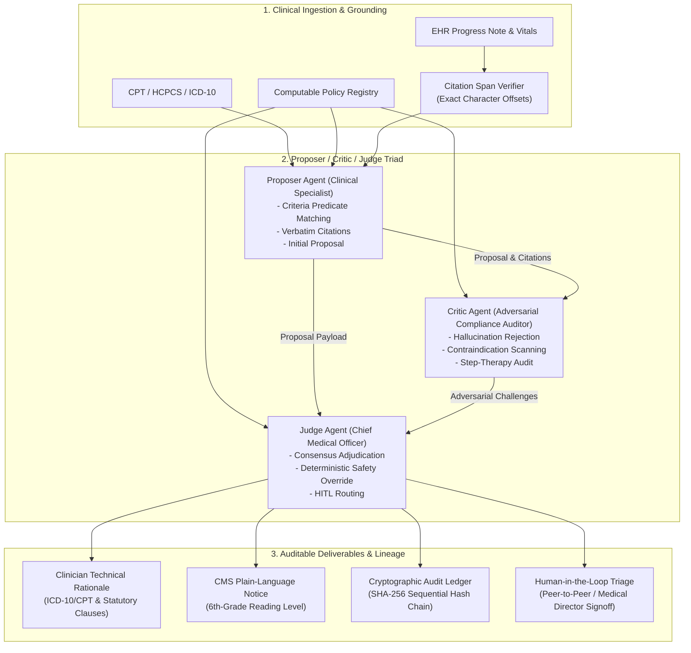

# VERIDICT: Policy-Grounded & Adversarial Decision Intelligence for Regulated Healthcare

[](veridict/tests)
[](pyproject.toml)
[](LICENSE)
[](docs/REGULATORY_COMPLIANCE.md)
[](docs/LOW_LEVEL_SPEC.md)

> **Verifiable, Deterministic & Adversarial Reasoning for High-Stakes Decisions across Prior Authorization, Utilization Management, Claims Integrity, and Care Management.**

---

## ⚡ Executive Summary

In regulated healthcare, automated decisions directly impact clinical care and insurance coverage. Traditional monolithic Large Language Models (LLMs) fail in these environments because:
1. **Hallucination & Citation Drift:** Generating fabricated lab values or misquoting clinical charts violates federal standards (CMS-0057-F and ERISA § 503).
2. **Confirmation Bias & Missed Exclusions:** Single-pass deciders routinely miss life-threatening contraindications (such as FDA Boxed Warnings for Medullary Thyroid Carcinoma in GLP-1 weight management).
3. **Audit Opacity:** Black-box decisions fail statutory appeal standards requiring dual-audience rationales (dense clinician rationales + plain-language member notices).

**VERIDICT** resolves these challenges through a three-part architectural pattern:
- **Computable Policy AST Engine:** Decouples deterministic clinical guidelines (inclusion, exclusion, step-therapy rules, lookback windows) from probabilistic text interpretation.
- **Proposer / Critic / Judge Triad:** An adversarial multi-agent review workflow where the Critic actively attempts to refute the Proposer's rationale, and the Judge enforces deterministic safety overrides.
- **Cryptographic Merkle Audit Trail:** Chains the 5 stages of decision lineage in a sequential SHA-256 hash tree, enabling immediate bit-level tamper detection.

---

## 🏛️ System Architecture



---

## 🏥 The 4 Regulated Healthcare Verticals

| Vertical | Clinical Domain | Policy ID | Key Adjudication Logic |
| :--- | :--- | :--- | :--- |
| **Prior Authorization (PA)** | GLP-1 Receptor Agonist (Wegovy) for Weight Management | `POL-PA-GLP1-2026` | Verifies BMI $\ge 30$, $\ge 6$-month lifestyle trial, and screens chart for FDA Boxed Warning contraindication (Medullary Thyroid Carcinoma). |
| **Prior Authorization (PA)** | Biologic Therapy (Humira) for Rheumatoid Arthritis | `POL-PA-HUMIRA-RA-2026` | Enforces mandatory 12-week conventional synthetic DMARD step-therapy trial and documented negative TB screening. |
| **Utilization Review (UM)** | Inpatient vs. Observation Stay (Chest Pain) | `POL-UM-CHESTPAIN-2026` | Adjudicates Part A Inpatient vs Part B Observation under the CMS Two-Midnight Rule (CMS-1599-F) based on serial troponins and hemodynamics. |
| **Claims Integrity** | Modifier 25 with Minor Surgical Procedure | `POL-CLAIMS-MOD25-2026` | Audits unbundled billing under CMS Claims Manual Ch. 12 § 30.6.6; detects E/M notes that merely duplicate procedure consent. |
| **Care Management** | Complex Heart Failure Transition of Care | `POL-CARE-HF-TOC-2026` | Stratifies 30-day readmission vulnerability via LACE score $\ge 10$, reduced ejection fraction, and SDOH barriers for immediate 48h outreach. |

---

## 🚀 Quickstart & Interactive Demonstration

### 1. Run the Pytest Verification Suite
```bash
pytest -v
```
All 12 unit and integration tests execute across deterministic adjudication, adversarial safety overrides, hallucination rejection, and cryptographic tamper detection.

### 2. Run CLI Demonstrations
```bash
# Run golden approval case
python3 -m veridict.cli run case_01_glp1_approve.json

# Run adversarial safety case (catches Medullary Thyroid Carcinoma contraindication)
python3 -m veridict.cli run case_02_glp1_deny_contraindication.json

# Run cryptographic tampering simulation (shows immediate SHA-256 break detection)
python3 -m veridict.cli verify-audit case_01_glp1_approve.json
```

### 3. Launch the Interactive Web Application & Recruiter Showcase
```bash
python3 -m veridict.cli serve --port 8000
```
Open **[http://127.0.0.1:8000](http://127.0.0.1:8000)** in your browser to explore:
- **Triad Studio:** Live case selector, interactive clinical note citation highlighter, side-by-side Proposer/Critic debate view, Judge adjudication, and dual rationales.
- **Tamper Simulation Lab:** Click "Simulate Malicious Tampering" to corrupt a bit in the proposer node and watch the Merkle DAG instantly pinpoint the exact failure point.
- **High-Level Understanding:** Interactive flowcharts, regulatory breakdown, and recruiter talking points.
- **Low-Level Architecture:** Technical data contracts, AST grammar, citation offset algorithms, and regulatory crosswalk.
- **Computable Policy Registry:** Machine-readable clinical guideline inspector.
- **Suite Benchmark:** One-click automated regression benchmark across all 6 cases.

---

## 📂 Repository Structure

```
.
├── README.md                          # Recruiter-facing portfolio overview
├── pyproject.toml                     # Python packaging and pytest configuration
├── docs/
│   ├── ARCHITECTURE.md                # System architecture, triad review pattern, safety contracts
│   ├── LOW_LEVEL_SPEC.md              # Data contracts, computable AST grammar, Merkle hash DAG
│   ├── REGULATORY_COMPLIANCE.md       # CMS-0057-F, ERISA § 503, Two-Midnight Rule, HIPAA
│   └── INTERVIEW_GUIDE.md             # Recruiter & technical interview talking points
└── veridict/
    ├── models/                        # Strongly typed Pydantic models
    │   ├── policy.py                  # Computable clinical policies & criteria
    │   ├── clinical.py                # Patient records, demographics & EHR snippets
    │   ├── review.py                  # Citations, Proposer, Critic & Judge outputs
    │   └── audit.py                   # Cryptographic audit nodes & Merkle packets
    ├── policies/                      # Machine-readable JSON policies
    │   ├── registry.py                # Policy loader and indexer
    │   ├── pa_glp1_wegovy.json        # GLP-1 weight management prior auth policy
    │   ├── pa_humira_ra.json          # Biologic rheumatoid arthritis policy
    │   ├── um_inpatient_chest_pain.json # Inpatient vs observation chest pain policy
    │   ├── claims_modifier_25.json    # Claims integrity modifier 25 policy
    │   └── care_mgmt_heart_failure.json # Heart failure transition-of-care policy
    ├── cases/                         # 6 Preloaded realistic clinical cases
    │   ├── case_01_glp1_approve.json
    │   ├── case_02_glp1_deny_contraindication.json
    │   ├── case_03_humira_step_therapy_fail.json
    │   ├── case_04_chest_pain_observation_vs_inpatient.json
    │   ├── case_05_modifier_25_unbundled_audit.json
    │   └── case_06_hf_transitions_care_mgmt.json
    ├── engine/                        # Core reasoning and adjudication engine
    │   ├── citation_verifier.py       # Zero-tolerance char-offset & hallucination verifier
    │   ├── proposer.py                # Proposer agent (clinical specialist)
    │   ├── critic.py                  # Critic agent (adversarial compliance auditor)
    │   ├── judge.py                   # Judge agent (chief medical officer / adjudicator)
    │   ├── audit_chain.py             # SHA-256 sequential hash chain & Merkle DAG builder
    │   └── orchestrator.py            # End-to-end execution pipeline
    ├── server/                        # FastAPI application & web showcase
    │   ├── app.py                     # REST API endpoints
    │   └── static/                    # Modern responsive enterprise web portal
    │       ├── index.html             # Documentation hub & Triad studio
    │       ├── style.css              # Dark-mode enterprise design system
    │       └── app.js                 # Dynamic citation highlighting & tamper lab
    ├── cli.py                         # Rich terminal runner
    └── tests/                         # Pytest test suite
        ├── test_engine.py             # End-to-end tests for all 6 cases
        ├── test_critic_catch_contraindication.py # Adversarial safety override test
        ├── test_citation_verifier.py  # Hallucination rejection unit tests
        └── test_audit_integrity.py    # Merkle hash chaining & tamper tests
```

---

## 🎯 Recruiter Talking Points Summary

When discussing this project with hiring managers in healthcare AI, health-tech, or enterprise AI:
1. **Explain the Regulatory Driver:** "Under CMS-0057-F and ERISA § 503, algorithmic denials cannot be black boxes. They must cite exact clinical criteria and verifiable text spans from patient records."
2. **Highlight the Triad Separation of Concerns:** "We separate the clinical advocate (Proposer) from the compliance auditor (Critic). The Critic is incentivized to find safety contraindications and hallucinated quotes."
3. **Emphasize Deterministic Overrides:** "If the Critic finds an FDA Boxed Warning contraindication, the Judge executes a deterministic safety override, guaranteeing patient safety over statistical likelihood."
4. **Demonstrate Cryptographic Lineage:** "Decisions generate a 5-node SHA-256 hash chain and Merkle root. Any historical alteration breaks the lineage and triggers an immediate tamper alert."

---

## 📄 License
Licensed under the Apache License, Version 2.0. See [LICENSE](LICENSE) for details.
