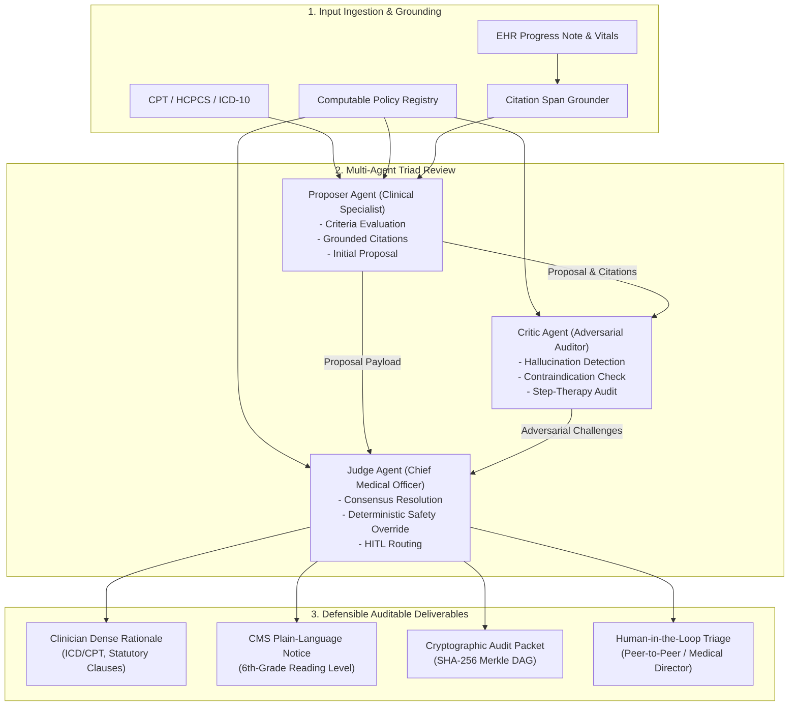

# VERIDICT Architecture Specification: Multi-Agent Triad Review for Regulated Decisions

## 1. Executive Summary & Problem Context

In high-stakes regulated domains—such as healthcare Utilization Management (UM), Prior Authorization (PA), Claims Integrity, and Care Management—decisions directly impact patient well-being, clinical outcomes, and health plan liability. 

Historically, automated adjudication has relied on brittle legacy rule engines or black-box algorithmic scorings. Recent attempts to introduce monolithic Large Language Models (LLMs) suffer from three fatal regulatory flaws:
1. **Probabilistic Hallucination & Citation Drift:** Models fabricate lab values, misquote clinical notes, or conflate diagnostic criteria. Under federal rules (CMS-0057-F and ERISA § 503), every determination must be strictly grounded in verifiable evidence.
2. **Failure to Detect Safety Contraindications:** Naïve generation often exhibits an "approval bias" or misses critical exclusions (e.g., FDA Black Box warnings for Medullary Thyroid Carcinoma in GLP-1 agonists).
3. **Black-Box Opacity:** Unexplainable outputs fail statutory appeals standards, which mandate dual-audience rationales: dense, code-grounded explanations for clinicians and 6th-grade reading level notices for patients.

**VERIDICT** resolves these failure modes by combining **machine-readable computable policy specifications**, an **adversarial Proposer / Critic / Judge review triad**, and **cryptographic tamper-evident Merkle hash chaining**.

---

## 2. System Architecture & Component Interaction

---

## 3. The Multi-Agent Triad Review Pattern

### 3.1 Proposer Agent (`Proposer-ClinicalSpecialist-v1`)
- **Role:** Primary synthesizer and clinical advocate.
- **Workflow:**
  1. Ingests patient demographics, structured facts (e.g., BMI, LVEF, trial durations), and raw chart notes.
  2. Queries the target computable policy for mandatory inclusion, step-therapy, and prerequisite criteria.
  3. Maps verified textual evidence spans to each criterion.
  4. Formulates a proposed determination (`APPROVE`, `DENY`, `REQUEST_MORE_INFO`, or `PARTIAL_APPROVAL`) with an initial confidence score.

### 3.2 Critic Agent (`Critic-ComplianceAuditor-v1`)
- **Role:** Adversarial compliance auditor and medical director reviewer.
- **Philosophy:** Actively assumes the Proposer is biased or erroneous. Specifically seeks reasons *why the proposal is invalid*.
- **Core Checks:**
  1. **Zero-Tolerance Citation Grounding:** Verifies that every quote proposed exists verbatim within character offsets in the raw EHR note. If a quote is fabricated or altered, it triggers a `BLOCKER` challenge for `HALLUCINATION`.
  2. **Adversarial Contraindication Scanning:** Scans the unstructured text for high-risk clinical exclusions (e.g., family history of medullary thyroid carcinoma or RET mutation for GLP-1 drugs; untreated latent TB for biologics; hospice election in care management).
  3. **Step-Therapy Duration & Lookback Auditing:** Verifies whether trial lengths meet policy thresholds (e.g., 12 weeks of conventional DMARDs).
  4. **Unbundling & Procedural Overlap:** In claims integrity, audits whether Modifier 25 was billed without separate cognitive medical decision making.

### 3.3 Judge Agent (`Judge-ChiefMedicalOfficer-v1`)
- **Role:** Autonomous adjudicator presiding over the Proposer/Critic debate.
- **Consensus & Divergence Formulation:**
  - Computes the consensus status: `UNANIMOUS`, `CHALLENGE_ACCEPTED`, `PROPOSER_UPHELD`, or `SAFETY_OVERRIDE_ENFORCED`.
  - Computes mathematical divergence score $D \in [0.0, 1.0]$.
- **Deterministic Safety Override Contract:**
  If the Critic identifies a `BLOCKER` challenge (e.g., active contraindication or hallucinated evidence), the Judge executes a hard statutory safety override, enforcing `DENY` or `ESCALATE_HUMAN` regardless of the Proposer's initial confidence!
- **Dual-Audience Generation:**
  - **Clinician/Auditor Rationale:** Technical, referencing policy IDs, ICD-10/CPT codes, exact clinical measurements, and statutory guidelines.
  - **Member Plain-Language Notice:** Compliant with CMS-0057-F readability mandates (~6th grade reading level), explaining why the service was or was not approved and outlining statutory appeal rights.

---

## 4. The 4 Regulated Verticals

| Vertical | Clinical Domain | Governing Regulatory Framework | Core Adjudication Challenge |
| :--- | :--- | :--- | :--- |
| **Prior Authorization (PA)** | GLP-1 Receptor Agonists (Wegovy) | CMS-0057-F; FDA Boxed Warnings; ERISA § 503 | Verifying BMI cutoff, 6-month lifestyle trial, and screening family history for Medullary Thyroid Carcinoma. |
| **Prior Authorization (PA)** | Biologics in Rheumatoid Arthritis (Humira) | American College of Rheumatology (ACR); State Step-Therapy Reform Acts | Enforcing 12-week conventional synthetic DMARD step-therapy trial and mandatory negative TB screening. |
| **Utilization Review (UM)** | Chest Pain / ACS Level of Care | CMS Two-Midnight Rule (CMS-1599-F; 42 CFR § 412.3); MCG / InterQual | Adjudicating Part A Acute Inpatient vs. Part B Observation Stay based on serial biomarkers, hemodynamics, and length of stay. |
| **Claims Integrity** | Modifier 25 with Minor Procedure | CMS Claims Processing Manual Ch. 12 § 30.6.6; OIG Work Plan | Detecting unbundled billing where E/M documentation merely duplicates procedure consent and lacks separate MDM. |
| **Care Management** | Heart Failure Transition of Care | CMS Hospital Readmissions Reduction Program (HRRP); NCQA CM Standards | Automated stratification for 48-hour post-discharge nurse outreach, remote biometric scales, and SDOH barrier mitigation. |

---

## 5. Human-in-the-Loop (HITL) Triage Boundaries

Under CMS-0057-F, approvals meeting 100% criteria with zero critic challenges can execute autonomously.
HITL routing to a licensed physician is mandatory under the following conditions:
1. **Adverse Benefit Determinations:** Any coverage denial must be reviewed and signed off by a qualified medical director.
2. **Safety Override Triggered:** Any case where a critic blocker overturned an approval.
3. **High Divergence ($D > 0.40$):** Disagreement between Proposer and Critic regarding evidentiary sufficiency.
4. **Peer-to-Peer Inquiry:** When missing information can be resolved via direct provider inquiry within statutory turnaround windows (72 hours expedited / 30 days standard).
