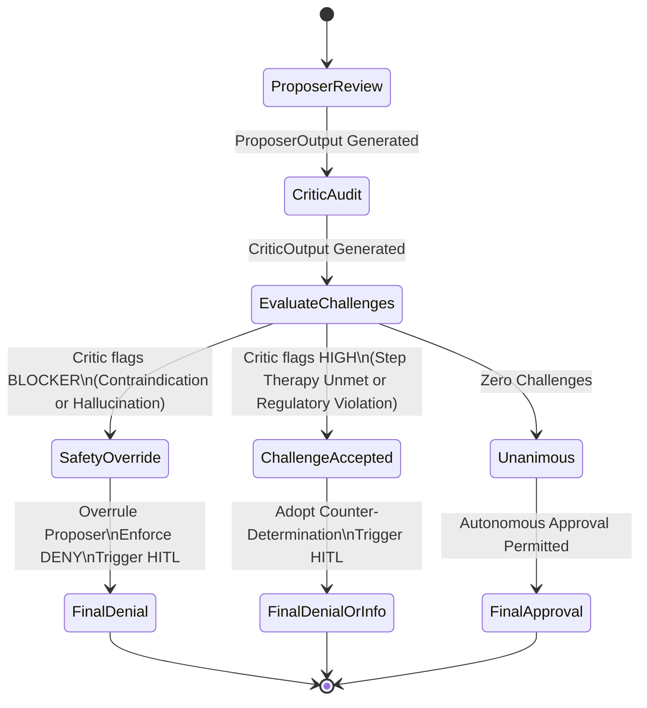

# VERIDICT Low-Level Technical Specification: Computable Policies, Grounding & Merkle Lineage

## 1. Computable Policy Representation & AST Grammar

In VERIDICT, clinical coverage guidelines (such as LCD/NCD manuals, FDA package inserts, and MCG/InterQual criteria) are transformed into computable Abstract Syntax Tree (AST) definitions encoded in strongly typed Pydantic models.

### 1.1 Criterion Definition
```python
class ClinicalCriterion(BaseModel):
    criterion_id: str             # Unique ID: CRIT-GLP1-BMI-HIGH
    name: str                     # Human-readable title
    description: str              # Clinical meaning
    criterion_type: CriterionType # INCLUSION | EXCLUSION | STEP_THERAPY | PREREQUISITE | DOCUMENTATION
    field_name: str               # Target structured clinical entity (e.g. "bmi")
    rule_operator: str            # Evaluation operator: ">=", "<=", "==", "in", "exists"
    threshold: Any                # Numerical or categorical threshold (e.g. 30.0, True, ["MODERATE", "SEVERE"])
    unit: Optional[str]           # "kg/m2", "weeks", "months", "mg/dL"
    lookback_days: Optional[int]  # Maximum clinical age in calendar days
    statutory_reference: str      # Legal/guideline source (e.g. "FDA Wegovy PI Sec. 1")
    is_mandatory: bool            # Whether satisfaction is strictly required
```

### 1.2 Logical Operators and Predicate Evaluation
Policies support composite grouping via `PolicyGroup`:
$$\text{GroupEvaluation}(G) = \begin{cases} 
\bigwedge_{c \in G} \text{Eval}(c) & \text{if } \text{operator} = \text{ALL\_OF} \\
\bigvee_{c \in G} \text{Eval}(c) & \text{if } \text{operator} = \text{ANY\_OF} \\
\left( \sum_{c \in G} \mathbb{I}(\text{Eval}(c)) \ge N \right) & \text{if } \text{operator} = \text{AT\_LEAST\_N}
\end{cases}$$

Where $\mathbb{I}$ is the indicator function, and $\text{Eval}(c)$ checks:
$$\text{Eval}(c) = \text{Value}(c.\text{field\_name}) \mathbin{c.\text{rule\_operator}} c.\text{threshold}$$

For criteria of type `EXCLUSION`, satisfaction of the condition constitutes a contraindication:
$$\text{ExclusionTriggered} \iff \text{Eval}(c) = \text{True}$$

---

## 2. Zero-Tolerance Citation Grounding Algorithm

In high-stakes health-tech, ungrounded citations violate federal truth-in-advertising and claims procedure laws (CMS-0057-F and ERISA § 503). 

### 2.1 The Verification Pipeline
Every extracted citation undergoes a 4-tier verification protocol:
1. **Tier 1: Verbatim Exact Substring Matching:**
   $$\text{offset} = \text{RawText}.\text{find}(\text{Quote})$$
   If $\text{offset} \neq -1$, set $\text{start\_char} = \text{offset}$, $\text{end\_char} = \text{offset} + \text{len}(\text{Quote})$, $\text{is\_verified} = \text{True}$, $\text{confidence} = 1.0$.
2. **Tier 2: Case-Insensitive Substring Matching:**
   Matches across capitalization variations (e.g. "bmi" vs "BMI").
3. **Tier 3: Whitespace & Linebreak Normalization:**
   Tokens are escaped and joined via regular expression `\s+` to accommodate line breaks and tab formatting across EHR systems.
4. **Tier 4: Rejection & Hallucination Flagging:**
   If the quote cannot be grounded to the source document, $\text{is\_verified} = \text{False}$, $\text{confidence} \le 0.1$, and the Critic triggers a `BLOCKER` challenge for `HALLUCINATION`.

---

## 3. Cryptographic Audit Chain & Merkle DAG Lineage

To establish an immutable chain of custody for every medical determination, VERIDICT generates a sequential SHA-256 hash chain and computes a hierarchical Merkle root over the 5 stages of review.

### 3.1 State Transition Hash Equations
Let $S_1, S_2, S_3, S_4, S_5$ denote the five review stages:
- $S_1 = \text{INPUT\_INGESTION}$
- $S_2 = \text{EVIDENCE\_EXTRACTION}$
- $S_3 = \text{PROPOSER\_SYNTHESIS}$
- $S_4 = \text{CRITIC\_REVIEW}$
- $S_5 = \text{JUDGE\_ADJUDICATION}$

Each node's cryptographic hash $H(N_i)$ is computed recursively:
$$H(N_1) = \text{SHA256}(\text{CanonicalJSON}(P_1) \parallel \text{"GENESIS"})$$
$$H(N_i) = \text{SHA256}(\text{CanonicalJSON}(P_i) \parallel H(N_{i-1})) \quad \text{for } i \in \{2, 3, 4, 5\}$$

Where:
- $\text{CanonicalJSON}(P)$ produces deterministic, whitespace-normalized, key-sorted JSON serialization.
- $\parallel$ denotes string concatenation.

### 3.2 Pairwise Merkle Tree Root
Given leaf hashes $L = [H(N_1), H(N_2), H(N_3), H(N_4), H(N_5)]$, the Merkle root $R$ is constructed by pairwise reduction:
$$H_{a,b} = \text{SHA256}(H_a \parallel H_b)$$
Repeated until a single 256-bit root hash $R$ is formed.

### 3.3 Tamper Detection Guarantee
If any historical record $P_j$ (e.g. clinical note, extracted fact, or proposer rationale) is altered after adjudication:
$$P_j \to P_j' \implies H(N_j) \ne H(N_j)' \implies \text{ParentHash}(N_{j+1}) \ne H(N_j)'$$
The verification algorithm immediately detects the exact stage of mutation and invalidates the Merkle root.

---

## 4. Deterministic Consensus & Safety Override Logic


